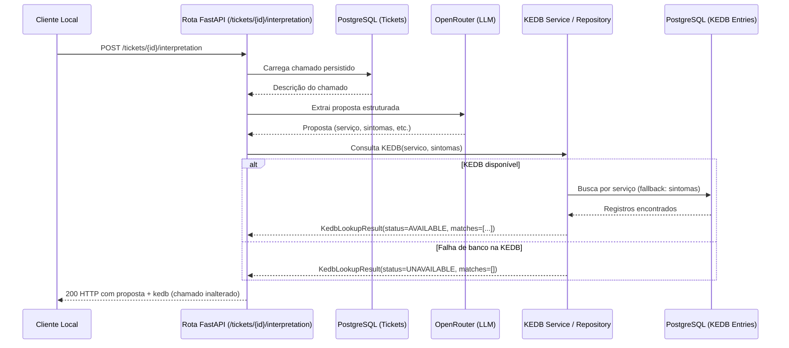

# Consulta à Base de Erros Conhecidos (KEDB) — Design

**Spec**: `.specs/features/kedb-lookup/spec.md`
**Status**: Approved

---

## Architecture Overview

A arquitetura estende o fluxo da rota local síncrona `POST /tickets/{ticket_id}/interpretation`. Após obter a proposta de interpretação via LLM (OpenRouter), a rota aciona um serviço determinístico local que consulta a KEDB no PostgreSQL a partir do serviço candidato e dos sintomas extraídos, anexando o resultado à resposta antes de entregá-la ao cliente.



O fluxo permanece síncrono e transacionalmente seguro:
- A proposta do LLM é preservada mesmo se a KEDB falhar (princípio de sucesso parcial).
- A consulta à KEDB é somente leitura (`SELECT`), não gerando mutações de estado no chamado nem novos eventos de auditoria.
- A comunicação com o OpenRouter continua enviando exclusivamente a descrição do chamado; nenhum dado da KEDB sai da máquina local.

---

## Research

- **Persistência**: O PostgreSQL já é utilizado com migrações SQL puras em `migrations/`. A adição da tabela `kedb_entries` e seu seed sintético ocorrerá via script `migrations/003_kedb_knowledge_base.sql`.
- **Normalização de texto**: A biblioteca padrão do Python (`unicodedata`) permite decomposição canônica (`NFKD`) para remoção determinística de marcas diacríticas (acentos), conversão para minúsculas (`casefold`/`lower`) e remoção de espaços duplicados/laterais.
- **Resiliência a falhas parciais**: O handler FastAPI captura exceções de banco durante a consulta da KEDB e degrada graciosamente para `status: "UNAVAILABLE"` com `matches: []`, preservando o código HTTP `200` com a interpretação principal.

---

## Code Reuse Analysis

### Existing Components to Leverage

| Component | Location | How to Use |
| --- | --- | --- |
| Rota de interpretação | `app/tickets/routes.py:post_ticket_interpretation` | Integrar a chamada da KEDB logo após a extração bem-sucedida do LLM. |
| Esquemas de interpretação | `app/triage/interpretation_schemas.py` | Estender `TicketInterpretationResponse` para conter o campo `kedb`. |
| Conexão PostgreSQL | `DATABASE_URL` via variável de ambiente | Conectar à base de dados para leitura da KEDB. |
| Fixtures de teste | `tests/integration/conftest.py` | Utilizar o banco de dados de teste PostgreSQL e o `TestClient` para testes ponta a ponta. |

### Integration Points

| System | Integration Method |
| --- | --- |
| PostgreSQL (`kedb_entries`) | Consulta SQL determinística com ordenação `ORDER BY error_id ASC`. |
| Proposta do LLM | Consome `service_candidate` e `symptoms` gerados por `interpret_description`. |
| API Local | Resposta JSON unificada contendo diagnóstico e catálogo de soluções paliativas. |

---

## Components and Interfaces

### 1. Migração de Banco (`migrations/003_kedb_knowledge_base.sql`)
- Cria a tabela `kedb_entries`:
  - `error_id VARCHAR(32) PRIMARY KEY`: identificador legível (ex: `ERR-001`).
  - `title TEXT NOT NULL`: título do erro conhecido.
  - `summary TEXT NOT NULL`: resumo do problema e causa raiz conhecida.
  - `service_candidate TEXT`: serviço ao qual o erro pertence (normalizado).
  - `symptoms TEXT[] NOT NULL`: lista de sintomas associados (normalizados).
  - `workaround TEXT NOT NULL`: procedimento detalhado de contorno.
  - `created_at TIMESTAMPTZ NOT NULL DEFAULT NOW()`.
- Insere registros sintéticos demonstrativos cobrindo serviços e sintomas comuns (ex.: conectividade VPN, autenticação de email, banco de dados, lentidão de ERP).

### 2. Normalizador de Texto (`app/triage/kedb_normalization.py`)
- Função pura `normalize_text(text: str | None) -> str`:
  - Retorna string vazia se nulo.
  - Executa `unicodedata.normalize('NFKD', text)`, remove caracteres combinantes de acentuação, converte para minúsculas e aplica `strip()`.

### 3. Esquemas Pydantic (`app/triage/kedb_schemas.py`)
- `KedbLookupStatus(str, Enum)`: `AVAILABLE = "AVAILABLE"`, `UNAVAILABLE = "UNAVAILABLE"`.
- `KedbMatch(BaseModel)`:
  - `error_id: str`
  - `title: str`
  - `summary: str`
  - `match_reasons: list[str]` (ex.: `["service: VPN Corporativa"]` ou `["symptom: tela azul"]`)
  - `workaround: str`
- `KedbLookupResult(BaseModel)`:
  - `status: KedbLookupStatus`
  - `matches: list[KedbMatch]`

### 4. Repositório e Serviço da KEDB (`app/triage/kedb_repository.py` & `app/triage/kedb_service.py`)
- `search_kedb(conn: psycopg.Connection, service_candidate: str | None, symptoms: list[str]) -> list[KedbMatch]`:
  - Normaliza os termos de entrada.
  - Se `service_candidate` estiver preenchido: busca registros com `service_candidate` correspondente. Se encontrar registros, retorna-os com `match_reasons=["service"]` ordenados por `error_id ASC`.
  - Fallback: se nenhum registro casar com o serviço (ou se não houver serviço), verifica se algum sintoma normalizado casa exatamente com itens do array `symptoms`. Retorna registros com `match_reasons=["symptom: <sintoma>"]` ordenados por `error_id ASC`.
- `lookup_kedb(database_url: str, service_candidate: str | None, symptoms: list[str]) -> KedbLookupResult`:
  - Conecta ao PostgreSQL e delega para `search_kedb`.
  - Em caso de falha de conexão/execução (`psycopg.Error`), captura o erro e retorna `KedbLookupResult(status=KedbLookupStatus.UNAVAILABLE, matches=[])`.

### 5. Rota HTTP (`app/tickets/routes.py`)
- Atualiza `post_ticket_interpretation`:
  - Após `proposal = interpret_description(ticket.description)`, executa `kedb = lookup_kedb(...)`.
  - Constrói `TicketInterpretationResponse` incluindo o campo `kedb`.

---

## Data Models

```sql
CREATE TABLE IF NOT EXISTS kedb_entries (
    error_id VARCHAR(32) PRIMARY KEY,
    title TEXT NOT NULL,
    summary TEXT NOT NULL,
    service_candidate TEXT,
    symptoms TEXT[] NOT NULL DEFAULT '{}',
    workaround TEXT NOT NULL,
    created_at TIMESTAMPTZ NOT NULL DEFAULT NOW()
);

CREATE INDEX IF NOT EXISTS idx_kedb_service ON kedb_entries (service_candidate);
```

---

## Risks & Concerns

| Risco / Preocupação | Impacto | Mitigação no Design |
| --- | --- | --- |
| Queda ou lentidão do PostgreSQL durante a consulta da KEDB | Potencial falha na resposta da interpretação | Tratamento explícito de exceção com retorno `UNAVAILABLE` e HTTP 200 (sucesso parcial). |
| Falso positivo de sintomas genéricos mascarando erros reais | Respostas ruidosas para o operador | Estratégia rígida `service_then_symptoms`: se o serviço casar, os sintomas são desconsiderados. |
| Divergência por acentos ou caixa alta/baixa | Não encontrar registros conhecidos por variação textual | Função centralizada de normalização `NFKD` aplicada tanto aos dados inseridos quanto aos termos de busca. |

