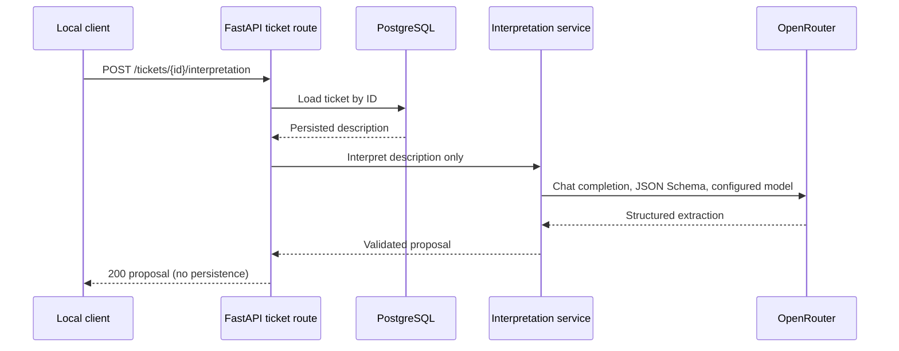

# LLM Ticket Interpretation Design

**Spec**: `.specs/features/llm-ticket-interpretation/spec.md`
**Status**: Approved

---

## Architecture Overview

The local synchronous API loads an existing ticket, passes only its persisted description to a dedicated interpretation service, validates the OpenRouter result, and returns a proposal. It does not mutate the ticket or invoke deterministic triage.

The approved approach is synchronous because the application uses synchronous FastAPI routes and PostgreSQL calls. The provider request has a 30-second timeout and no automatic retry. The request uses OpenRouter's Chat Completions endpoint with a strict JSON Schema response format. Provider routing must require compatible parameters because structured-output support varies by model endpoint.

## Research

- The repository has synchronous FastAPI handlers and psycopg repository functions; no LLM or outbound HTTP client exists.
- No `.specs/STATE.md` project decisions file exists. No confirmed lessons are recorded.
- OpenRouter documents `POST https://openrouter.ai/api/v1/chat/completions`, bearer API-key security, and a response `choices[].message.content` shape for non-streaming completions: [Chat Completions API reference](https://openrouter.ai/docs/api/api-reference/chat/create-a-chat-completion).
- OpenRouter documents `response_format` with `type: json_schema` for Chat Completions. Support depends on the selected model and provider endpoint; its guidance recommends `provider.require_parameters: true`: [Structured Outputs](https://openrouter.ai/docs/guides/features/structured-outputs).
- Context7 documentation search was unavailable in the toolset; the official OpenRouter documentation above was used.

## Code Reuse Analysis

### Existing Components to Leverage

| Component | Location | How to Use |
| --- | --- | --- |
| Ticket lookup | `app/tickets/repository.py:get_ticket` | Load an existing persisted description and return 404 before making an external call. |
| Ticket HTTP adapter | `app/tickets/routes.py` | Add the local interpretation route and map upstream failures to stable HTTP errors. |
| Ticket response facts | `app/triage/schemas.py` | Reuse `Impact` and `Urgency` enums so proposed facts use the deterministic domain's accepted values. |
| Test database and API client | `tests/integration/conftest.py` | Test real ticket lookup and verify the ticket and audit state remain unchanged. |

### Integration Points

| System | Integration Method |
| --- | --- |
| PostgreSQL | Read ticket by ID only; do not write ticket or audit records. |
| OpenRouter | Synchronous standard-library HTTP request to Chat Completions; isolate request/response parsing in a provider client. |
| Deterministic triage API | No automatic call. A client may explicitly submit resolved fact IDs through the existing route after review. |

## Components

### Ticket interpretation route

- **Purpose**: Load the requested ticket, invoke extraction for its persisted description, and return a proposal.
- **Location**: `app/tickets/routes.py`
- **Interface**: `POST /tickets/{ticket_id}/interpretation`; no request body.
- **Dependencies**: `get_ticket`, interpretation service.
- **Reuses**: Existing local ticket API and UUID validation.

### Interpretation schemas

- **Purpose**: Define the strict model-output and API-response contract.
- **Location**: `app/triage/interpretation_schemas.py`
- **Interfaces**: `InterpretationProposal` is the provider JSON Schema for candidates, allowed impact/urgency enums, symptoms, evidence, missing information, uncertainties, and summary. `TicketInterpretationResponse` adds the path `ticket_id` only after the provider response is validated.
- **Dependencies**: Pydantic and `Impact`/`Urgency` from `app/triage/schemas.py`.
- **Reuses**: Existing domain enums; service/asset candidates remain free text, not catalog IDs.

### OpenRouter client

- **Purpose**: Perform one bounded outbound request and decode a Chat Completions response.
- **Location**: `app/triage/openrouter_client.py`
- **Interface**: Accept configured model, API key, and description; return validated extraction data or a typed provider error.
- **Dependencies**: Python standard library (`urllib.request`, JSON, environment/config values).
- **Reuses**: No existing provider client.
- **Constraints**: `OPENROUTER_API_KEY` and `OPENROUTER_MODEL` are required; send only the description as ticket data; set non-streaming JSON Schema output, strict schema, `require_parameters: true`, and a 30-second network timeout; do not retry.

### Interpretation service

- **Purpose**: Apply the extraction instructions and coordinate the client with response validation.
- **Location**: `app/triage/interpretation.py`
- **Interface**: `interpret_description(description: str) -> TicketInterpretation`
- **Dependencies**: OpenRouter client, environment configuration, Pydantic schema.
- **Reuses**: Existing deterministic `Impact` and `Urgency` enums only; does not invoke triage rules.

## Data Models

### InterpretationProposal and TicketInterpretationResponse

The provider schema contains only these extracted values and is the API response shape before the route adds its path identifier:

- `service_candidate: str | None`
- `asset_candidate: str | None`
- `impact: Impact | None`
- `urgency: Urgency | None`
- `symptoms: list[str]`
- `impact_evidence: list[str]`
- `urgency_evidence: list[str]`
- `missing_information: list[str]`
- `uncertainties: list[str]`
- `technical_summary: str | None`

All fields are required in the provider JSON Schema; nullable facts use explicit `null`, and lists may be empty. Extra properties are forbidden. The output excludes priority, target team, numeric confidence, and catalog identifiers.

`TicketInterpretationResponse` wraps the validated proposal with `ticket_id`. The ticket identifier is never included in the provider schema or request.

## Error Handling Strategy

| Error Scenario | Handling | User Impact |
| --- | --- | --- |
| Ticket does not exist | `404`; do not call provider | No proposal; no state change. |
| Required provider configuration missing | `503`; no outbound call | Clear service-unavailable result; ticket unchanged. |
| Timeout, provider HTTP error, or rate limit | `503`; no retry | Clear service-unavailable result; caller may retry manually. |
| Malformed envelope, missing content, or invalid extraction schema | `502`; do not expose raw provider content | Clear invalid-upstream-response result; ticket unchanged. |
| Valid partial extraction | `200` with null unresolved fields and review details | Caller can review and decide whether to prepare a deterministic request. |
| Invalid path UUID | Existing FastAPI UUID validation (`422`) | Provider is not called. |

## Risks & Concerns

| Concern | Location | Impact | Mitigation |
| --- | --- | --- | --- |
| Ticket descriptions may contain sensitive incident data and leave the local machine | `app/triage/openrouter_client.py` | Data is transmitted to the user's configured cloud provider. | The user explicitly approved sending only the description; never send identifiers/catalog/other ticket fields, never log content, and document the provider boundary. |
| Ticket text can contain prompt-injection instructions | Provider prompt / extraction service | Model may emit incorrect or adversarially influenced suggestions. | Treat the description as untrusted input, use no tools or action capabilities, validate every output field, return suggestions only, and require a separate deterministic API request. |
| Configured models/endpoints may not support structured outputs | OpenRouter client | Provider may reject the request or return invalid content. | Require compatible provider parameters, validate returned JSON independently, return explicit errors, and test using a mocked provider. |
| Provider latency or outage blocks the synchronous request | `app/triage/openrouter_client.py` | Local caller waits for the upstream request. | Enforce the approved 30-second timeout, disable automatic retries, and return `503`. |
| There are no current outbound-provider test patterns | `tests/integration/test_triage_api.py` | Tests could accidentally make live calls or miss transport behavior. | Mock the standard-library HTTP boundary and assert request body, bearer header, timeout, provider call count, and unchanged database state. |

## Tech Decisions

| Decision | Choice | Rationale |
| --- | --- | --- |
| Request execution | Synchronous | Matches the repository's existing route and repository patterns. |
| HTTP transport | Python standard library | Avoids adding a runtime dependency for one provider request. |
| Structured response | OpenRouter Chat Completions with strict JSON Schema | Produces a bounded extraction contract; application-side Pydantic validation remains authoritative. |
| Proposal lifecycle | In-memory response only | The approved flow does not persist model output or change ticket state. |
| Model selection | Required `OPENROUTER_MODEL` setting | Avoids hidden model, cost, or behavior selection. |
| Project-level decisions | None | These choices are limited to this feature and do not establish a broader project convention. |
